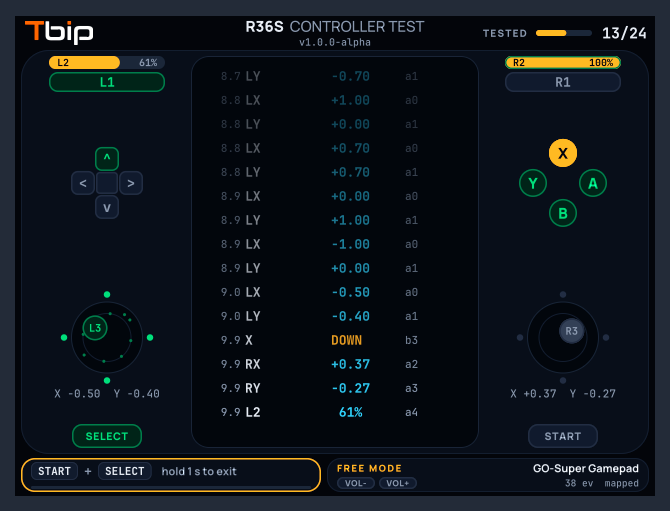
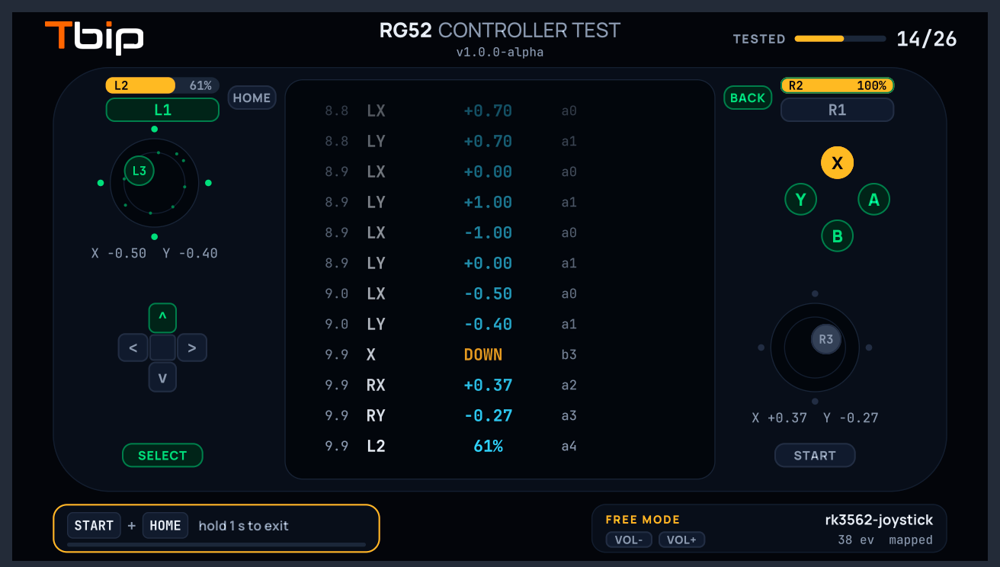

<p align="left">
  <picture>
    <source media="(prefers-color-scheme: dark)" srcset="docs/tbip-light.svg">
    <source media="(prefers-color-scheme: light)" srcset="docs/tbip-dark.svg">
    
  </picture>
</p>

<p align="left"><strong>Turning Bits Into Products</strong></p>

# controller-test

Mostra na tela, em tempo real, tudo o que um controle compatível com o dArkOS envia: cada botão,
os dois gatilhos analógicos, os dois analógicos e as teclas de volume. Segue o mesmo visual do
`led-rgb` e do `system-info`. Substitui o `Controller Tester.sh` do dArkOS, que só despeja valores
numéricos (ele roda um binário fechado, `controllerTester`).

| R36S | RG52 Mini |
|---|---|
|  |  |

## Como sair (importante)

**Segure por 1 segundo a combinação mostrada no rodapé:** START + HOME no RG52 Mini, RG43 Pro e família
RK3566, ou START + SELECT no R36S, RGB10, A10 Mini e perfil genérico. Uma barra verde enche no cartão; se soltar um dos
botões antes de completar, nada acontece. Nenhum outro botão fecha o app. No PC, segurar `Esc` por 1 s
também sai.

## Aparelhos

O app identifica o aparelho nesta ordem: `--device`, `/home/ark/.config/.DEVICE`, hostname e chip no
device tree. Só os controles do perfil aparecem e contam no progresso. Um evento de controle fora do
perfil continua no log.

| Perfil (`--device`) | Marcadores do dArkOS | Analógicos | Itens | Saída |
| --- | --- | --- | --- | --- |
| `rg52mini` | RG52MINI | 2 | 26 | START + HOME |
| `rg43` | RG43H | 2 | 25 | START + HOME |
| `r36s` | RG351MP | 2 | 24 | START + SELECT |
| `rgb10` | RGB10 | 1 | 20 | START + SELECT |
| `a10mini` | A10MINI, A10MINIV4 | 2 | 25 | START + SELECT |
| `rk3566` | RG353M, RG353V, RG503, RK2023, RGB30, RGB20PRO, MINILOONG | 2 | 25 | START + HOME |
| `generic` | aparelho não identificado | 2 | 26 | START + SELECT |

A tela usa a resolução real informada pelo SDL: layout largo a partir de 16:10 e compacto em 4:3, 3:2
e telas quadradas. Para adicionar um aparelho, crie um arquivo em `src/devices/` e registre-o em `ALL`.

Se o HOME não aparecer no seu aparelho (o SDL não tem nome para ele), veja o log: o botão aparece como
`bN` ("not mapped"). Aí use essa combinação: `--exit start+b12` (ou `EXIT_COMBO=start+b12` no script).
Se nem o botão cru aparecer, o sistema está consumindo o HOME antes do app; use outra combinação, ex.
`--exit start+select`. Em último caso, segurar o botão de energia desliga o aparelho.

## A tela

- **Aparelho desenhado de frente**, em uma disposição compatível com controles dArkOS: HOME e BACK ao lado da tela,
  analógico esquerdo acima do direcional, ABXY acima do analógico direito, SELECT e START embaixo,
  L1/L2 e R1/R2 nos ombros (L2/R2 são as barras analógicas). O clique dos analógicos é L3/R3. O que está **apertado** fica na cor de destaque; o que **já foi testado** fica
  verde, então no fim você vê de relance o que falta.
- **Gatilhos:** barra proporcional e porcentagem (são analógicos, Hall). Contam como testados ao chegar
  a 90 %.
- **Analógicos:** posição ao vivo (`X`, `Y` de −1 a +1), quatro marcas que acendem quando o analógico
  chega ao fim do curso em cada direção, e pontos verdes mostrando até onde cada setor já chegou
  (um contorno redondo e completo = curso bom; falhas = zona morta ou mecânica torta).
- **Contador `14/26`:** 16 botões (incluindo HOME e BACK) + 4 direções × 2 analógicos + 2 gatilhos.
- **Registro de eventos** (sem título, letras grandes; no lugar da "tela" do aparelho): hora, controle, ação e **origem** (`b1`, `a0`, `h0.1`...)
  de cada evento. Eixos que mexem sem parar viram uma linha só atualizada, para não inundar.
  Botões sem nome no mapeamento do SDL aparecem em laranja como `bN`/`aN`/`hN` — o hardware mandou, o
  mapeamento é que não conhece.
- **Teclas de volume** (VOL −/+) acendem se o sistema as entregar como teclado.
- O cartão de informações mostra o dispositivo, nº de botões/eixos/hats e se há mapeamento.
- **FREE MODE:** modo livre. (Modo com valores esperados: próxima revisão.)

## HOME e BACK

O SDL só conhece o botão `guide` (normalmente o HOME); o botão BACK pode não ter nome. Ambos são tratados
assim, nesta ordem: (1) o nome do mapeamento do SDL (`guide` → HOME); (2) teclas do sistema `AC Home` /
`AC Back`; (3) a atribuição manual `--map`. Se apertar HOME ou BACK e o desenho não acender, olhe o log:
um botão laranja `bN` ("not mapped") quer dizer que o aparelho enviou mas ninguém deu nome a ele.
Atribua e rode de novo:

```bash
./controller-test --map back=b13,home=b12      # ou MAP=back=b13,home=b12 no script
```

(use os números `bN` que apareceram no log). Se HOME/BACK não aparecem nem como `bN`, o sistema os
consome antes do app e não há como lê-los por aqui.

## Compilar (no aparelho, Debian Trixie arm64)

```bash
sudo apt install cargo libsdl2-dev pkg-config
cargo build --release          # binário: target/release/controller-test
```

Só biblioteca e testes, sem SDL2: `cargo test --no-default-features`. Compatível com rustc antigo
(`rust-version = "1.80"`).

## Instalar no menu Tools

1. Copie `scripts/Controller Test.sh` para a pasta dos scripts do menu Tools (onde está o
   `LED Settings.sh`) e `chmod +x`.
2. Copie o binário para `controller-test/controller-test` ao lado do `.sh` (ou só ao lado, ou
   `/opt/controller-test/controller-test`).
3. Reabra o menu: aparece "Controller Test". Se falhar, a tela mostra o fim de `/tmp/controller-test.log`.

O script **não usa o `gptokeyb`** (ele transformaria os botões em teclas e atrapalharia o teste) e usa o
mesmo `gamecontrollerdb.txt` do restante do dArkOS. Variáveis: `EXIT_COMBO`, `MAP`, `LAYOUT=xbox`, `ACCENT=teal`,
`SDL_VIDEODRIVER=kmsdrm` (só se a tela ficar preta).

## Opções

```
--fullscreen      tela cheia
--device ID       auto (padrão), rg52mini, rg43, r36s, rgb10, a10mini, rk3566 ou generic
--exit COMBO      combinação de saída (padrão: a do aparelho); aceita start, select, home, l1... e bN
--map LISTA       atribui botões crus ao desenho: back=b13,home=b12
--layout L        nintendo (A à direita, B embaixo, X em cima, Y à esquerda; padrão) ou xbox
--accent COR      amber, teal, violet, coral ou #RRGGBB
--list            lista os controles (nome, GUID, nº de botões/eixos e o mapeamento SDL) e sai
--screenshot PPM  desenha um quadro de exemplo sem abrir janela
--size LxA        tamanho do --screenshot (padrão 1280x720)
```

`--list` é a ferramenta de diagnóstico: se algum botão não responde, rode no aparelho e me mande a saída.

## Como funciona

Cada controle é aberto de dois jeitos no SDL2: como *game controller* (nomes A, B, START, HOME... pelo
mapeamento) e como joystick cru. Eventos nomeados desenham o controle; o joystick cru só entra no log
para o que o mapeamento **não** cobre, sem duplicar. Teclado (volume etc.) também vai para o log.

## Estrutura

```
src/devices/    um arquivo por aparelho (controles, saída, disposição) e a detecção (detect.rs)
src/pad.rs      estado do teste (testados, alcance dos analógicos, combinação de saída, log) e leitor do mapeamento SDL
src/ui.rs       tela adaptada ao aparelho e à proporção: controle desenhado, log, cartões; cache para ficar leve
src/gfx.rs      rasterizador por software (o mesmo dos outros apps)
src/main.rs     laço SDL2, abertura dos controles, tradução de eventos
assets/fonts/   Manrope e JetBrains Mono (subsets ASCII, SIL OFL)
scripts/Controller Test.sh   item do menu Tools
```

## Verificado e não verificado

Verificado em x86_64: lógica do estado e da saída (40 testes), leitura do mapeamento, desenho (pixels
conferidos), e um teste ponta a ponta com um **joystick virtual do SDL** (mapeamento real, eventos reais,
botão sem mapeamento aparecendo como cru, hat, gatilho e combinação de saída com botão cru). Um quadro
leva ~3 ms aqui.

**Não testado em todos os aparelhos:** o mapeamento específico (se HOME, L2/R2 e os cliques dos analógicos
têm nome), as teclas de volume, o launcher no EmulationStation e o vídeo KMSDRM. A disposição física pode
variar conforme o modelo compatível.

## Versão e logo

O cabeçalho (`src/header.rs`, igual nos quatro apps) mostra o logo Tbip à esquerda e, no centro, o
aparelho, o app e a versão do `Cargo.toml`. O logo é `docs/tbip-letras-branca.svg` rasterizado em
`assets/logo_tbip_248x87.rgba` (RGBA bruto embutido no binário).

---

Ferramentas open source para consoles portáteis com dArkOS

A **Tbip** (*Turning Bits Into Products*, ou "transformando bits em produtos") desenvolve ferramentas **open source** para o [dArkOS](https://github.com/christianhaitian/dArkOS), sistema usado em consoles portáteis de jogos. Nosso objetivo é substituir telas de terminal e scripts por interfaces gráficas claras, feitas para usar com os botões do próprio aparelho.

Todas as ferramentas são escritas em **Rust** e usam **SDL2**. Elas identificam o aparelho automaticamente, mostram apenas o que ele possui e adaptam o layout à tela. 


## Open source

Nossos projetos são distribuídos sob a **licença MIT**. Você pode usar, estudar, modificar e redistribuir o código, inclusive em outros projetos, desde que mantenha o aviso de copyright e a licença.
